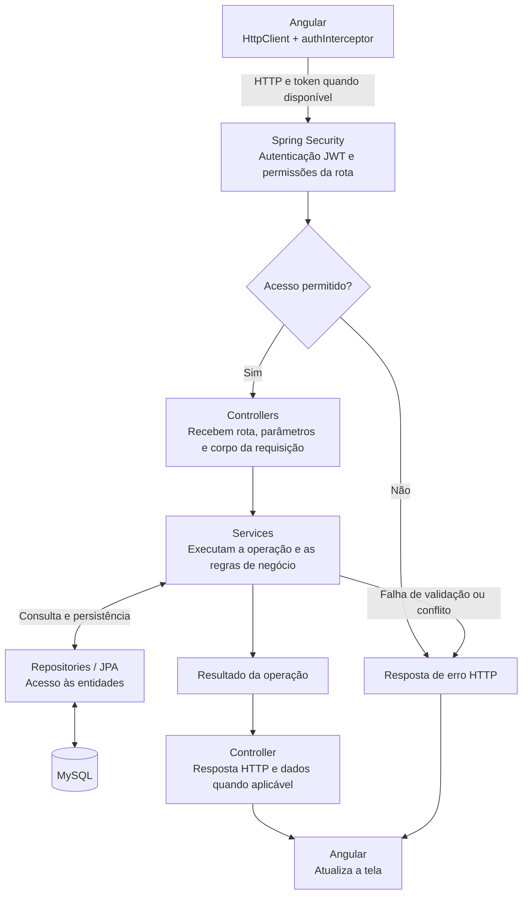
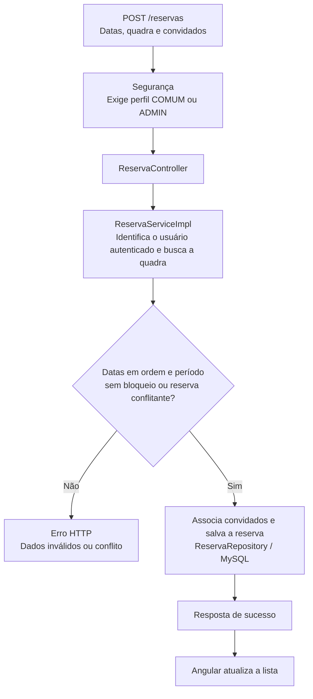

# play-senac-api

Backend de um projeto colaborativo de agendamento de quadras do Centro Universitário Senac. A API centraliza autenticação, quadras, reservas e bloqueios administrativos. O histórico preserva as contribuições dos participantes.

## Demonstração e imagens

[Frontend](https://github.com/GuilhermeSerafim/play-senac) · [Case](https://guiler.vercel.app). Não há alegação de disponibilidade atual da implantação original.

## Arquitetura e implementação

Controllers/DTOs expõem operações REST; services concentram regras e repositories acessam MySQL por JPA. Há autenticação JWT, perfis COMUM/ADMIN e validações de colisão entre reservas e bloqueios. O banco usa atualização automática do schema; as roles precisam ser cadastradas manualmente.

## Fluxo da API

O Angular envia uma requisição HTTP. A API verifica o acesso, encaminha a operação para a regra de negócio e usa os repositories para consultar ou salvar dados.



- **Segurança:** rotas públicas, como login e consulta de quadras, dispensam autenticação. Nas rotas protegidas, o token identifica o usuário e as permissões dependem do perfil `COMUM` ou `ADMIN`.
- **Controllers e DTOs:** recebem os dados da requisição e definem os dados de entrada e saída das operações.
- **Services:** concentram regras como verificar sobreposição de reservas, bloqueios de quadras e quem pode cancelar uma reserva.
- **Repositories e entidades:** representam e acessam os registros no MySQL por meio do JPA.

### Exemplo: criação de reserva



O usuário da nova reserva é obtido da autenticação. O frontend envia os dados do agendamento; a decisão sobre aceitar a operação fica na API.

## Estrutura de pastas

```text
play-senac-api/
├── src/
│   ├── main/
│   │   ├── java/com/playsenac/api/
│   │   │   ├── controller/       # Endpoints REST de login, usuários, quadras e reservas
│   │   │   ├── dto/              # Objetos de entrada e saída das operações
│   │   │   ├── entities/         # Entidades e relacionamentos mapeados pelo JPA
│   │   │   ├── repository/       # Consultas e persistência no banco
│   │   │   ├── security/         # JWT, perfis, permissões e configuração de CORS
│   │   │   ├── service/          # Serviços e contratos das operações
│   │   │   │   └── impl/         # Implementações das regras de negócio
│   │   │   └── ApiApplication.java # Inicialização do Spring Boot
│   │   └── resources/
│   │       └── application.properties # Banco, JPA e configuração do token
│   └── test/java/com/playsenac/api/ # Teste de carregamento do contexto
├── .mvn/                         # Configuração do Maven Wrapper
├── mvnw / mvnw.cmd               # Execução do Maven no Linux/macOS e Windows
├── pom.xml                       # Dependências e configuração do build
└── Dockerfile                    # Construção da imagem da API
```

Para localizar uma operação, comece por `controller/`, siga para `service/` e consulte `repository/` quando houver acesso ao banco. Os formatos dos dados estão em `dto/` e os relacionamentos persistidos em `entities/`.

## Instalação e configuração

Requer Java 21 e MySQL 8 ou superior. O repositório inclui Maven Wrapper. No PowerShell, na raiz, configure um banco e credenciais locais:

```powershell
$env:DB_URL='jdbc:mysql://localhost:3306/play_senac?createDatabaseIfNotExist=true&serverTimezone=America/Sao_Paulo'
$env:DB_USER='<usuario_mysql_local>'
$env:DB_PASSWORD='<senha_mysql_local>'
$env:TOKEN_CHAVE='<segredo_aleatorio_exclusivo_do_ambiente_local>'
.\mvnw.cmd spring-boot:run
```

Substitua os placeholders antes de executar. A API usa a porta 8080. Em Linux/macOS, configure as mesmas variáveis no shell e execute `./mvnw spring-boot:run`.

`TOKEN_CHAVE` é texto lido em UTF-8 e transformado por SHA-256 para assinatura HS256; o código não decodifica Base64 nem valida o tamanho original do segredo. Use um segredo aleatório exclusivo, mantenha-o fora do Git e estável entre as execuções do mesmo ambiente.

Depois que a aplicação criar as tabelas, execute no banco **local**:

```sql
INSERT IGNORE INTO `Role` (id_role, nome)
VALUES (1, 'COMUM'), (2, 'ADMIN');
```

O cadastro público depende de `COMUM` com `id_role = 1`. Ainda não há migrações versionadas nem seed automático. Consulte as entidades e o schema existente antes de aplicar esse SQL a um banco já utilizado.

## Testes e verificações

Os comandos abaixo documentam a suíte existente; não representam uma execução nova nem um resultado de aprovação.

Em outro terminal na raiz, com as variáveis acima configuradas e o banco local disponível:

```text
.\mvnw.cmd test
```

## Limites atuais

- A suíte contém teste de carregamento de contexto; faltam testes das regras de conflitos, propriedade e permissões.
- A leitura estática da atualização administrativa indica que ela pode alterar o proprietário da reserva; esse comportamento precisa ser validado contra a regra de negócio. Não foi observado em execução nesta revisão.
- ddl-auto=update não substitui estratégia de migração versionada; a configuração local não implica prontidão de produção.

<details>
<summary>Referência de uso e documentação complementar</summary>

## Como rodar com Docker

Build da imagem:

```powershell
docker build -t play-senac-api .
```

Execucao do container:

```powershell
docker run --rm -p 8080:8080 --env-file .env play-senac-api
```

Observacao:

- o container tambem precisa das mesmas variaveis `DB_URL`, `DB_USER`, `DB_PASSWORD` e `TOKEN_CHAVE`

No container, `DB_URL` deve apontar para um banco acessível a partir dele. O endereço precisa corresponder à sua configuração local de rede.

## Documentacao e endpoints utilitarios

- Swagger UI: `http://localhost:8080/swagger-ui/index.html`
- OpenAPI JSON: `http://localhost:8080/v3/api-docs`
- Ping publico: `GET http://localhost:8080/api/public/ping`

Exemplo de resposta do ping:

```json
{
  "status": "ok",
  "service": "Play Senac API"
}
```

## Autenticacao

O login e feito em `POST /login` com email e senha.

Exemplo de payload:

```json
{
  "email": "<email_do_usuario_local>",
  "senha": "<senha_do_usuario_local>"
}
```

Resposta esperada:

```json
{
  "email": "<email_do_usuario_local>",
  "role": "COMUM",
  "token": "<token_jwt_retornado_pela_api>"
}
```

Para acessar rotas protegidas, envie o header:

```http
Authorization: Bearer <token>
```

## Perfis de acesso

Rotas publicas:

- `POST /login`
- `POST /usuarios/cadastro`
- `GET /quadras`
- `GET /quadras/{id}`
- `GET /api/public/ping`
- `GET /swagger-ui/**`
- `GET /v3/api-docs/**`

Rotas para usuario autenticado:

- `PUT /usuarios/atualizar`
- `DELETE /usuarios/deletar/`

Rotas exclusivas de `COMUM`:

- `GET /usuarios/buscar`
- `GET /reservas/minhas`

Rotas de `COMUM` e `ADMIN`:

- `POST /reservas`
- `DELETE /reservas/{id}`

Rotas exclusivas de `ADMIN`:

- `POST /quadras`
- `PUT /quadras/{id}`
- `DELETE /quadras/{id}`
- `GET /reservas`
- `GET /reservas/{id}`
- `PUT /reservas/{id}`
- `GET /bloqueios`
- `GET /bloqueios/{id}`
- `POST /bloqueios`
- `PUT /bloqueios/{id}`
- `DELETE /bloqueios/{id}`

## Rotas principais

| Metodo | Rota | Acesso | Descricao |
| --- | --- | --- | --- |
| `POST` | `/usuarios/cadastro` | Publico | Cadastra um novo usuario |
| `POST` | `/login` | Publico | Gera token JWT |
| `GET` | `/quadras` | Publico | Lista as quadras disponiveis |
| `GET` | `/quadras/{id}` | Publico | Busca uma quadra por id |
| `GET` | `/usuarios/buscar` | `COMUM` | Retorna os dados do usuario autenticado |
| `PUT` | `/usuarios/atualizar` | Autenticado | Atualiza o proprio cadastro |
| `POST` | `/reservas` | `COMUM` ou `ADMIN` | Cria uma reserva |
| `GET` | `/reservas/minhas` | `COMUM` | Lista reservas do usuario logado |
| `GET` | `/reservas` | `ADMIN` | Lista todas as reservas |
| `POST` | `/bloqueios` | `ADMIN` | Bloqueia uma quadra em um intervalo |

Use o Swagger para consultar o contrato completo das respostas e todos os campos disponiveis.

## CORS

As origens liberadas na configuracao atual sao:

- `http://localhost:4200`
- `http://127.0.0.1:4200`
- `https://play-senac.vercel.app`

## Links relacionados

- Frontend: [play-senac](https://github.com/GuilhermeSerafim/play-senac)
- Prototipo: [Figma](https://www.figma.com/proto/k0ublZXSnKWTw9W9YGRCF7/Play-Senac?node-id=74-66&t=imzkF1T5s64SmrGi-1)

</details>
